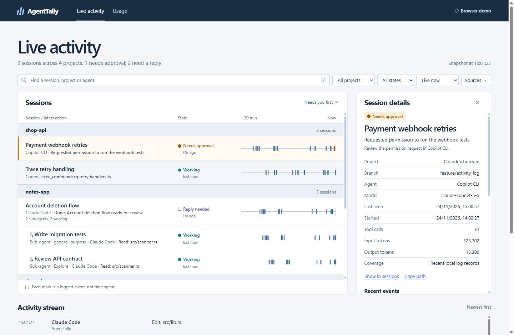
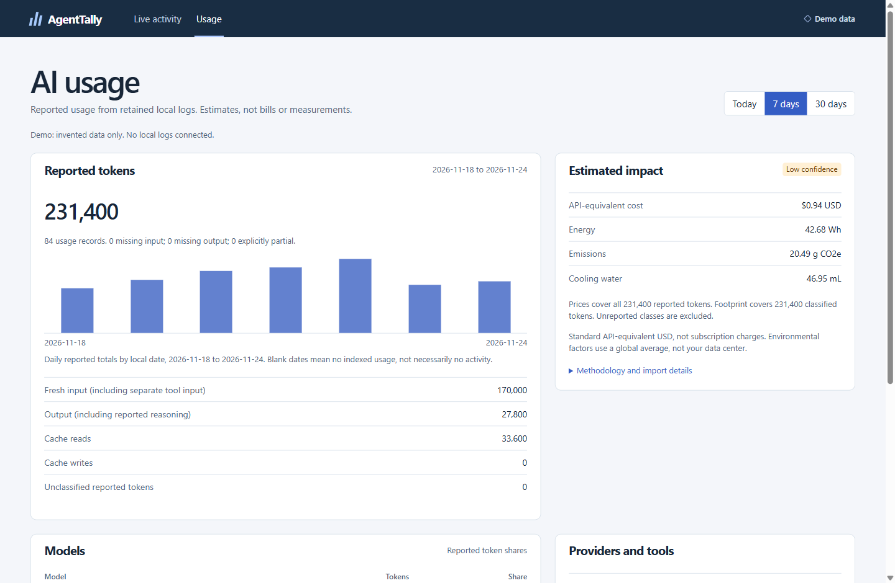

## Live agent activity, at a glance

AgentTally now opens to the question that matters when several agents are running: **which one needs me?** The dashboard groups sessions by project, shows each agent’s latest action, and puts permission requests and replies ahead of background work.

Each mark on the shared 30-minute timeline is a logged event, not time spent. Select a session to see its model, branch, and recent actions. Minimize the dashboard and a compact status window keeps the highest-priority session visible. Approvals and replies still happen in the original agent app.

## Where did the tokens go?

Open **Usage** to compare today, the last 7 days, or the last 30 days. See reported tokens by model and provider, tool calls by category, and how much of the total has enough information for a cost or footprint estimate.

Both screenshots use sample data. Your history is indexed on your device from logs that are still available. No account or API key is needed. Cost is an **API-equivalent estimate**, not your bill; environmental figures are estimates, not measurements. [How the estimates work](https://github.com/kasuken/AgentTally/blob/v0.5.0/docs/usage-methodology.md).

**Upgrading from v0.4.0:** Install the new version normally. The dashboard replaces Pixel (including Cinema mode) and Pro, and the compact status window replaces the robot. No manual migration is required.

## Downloads

| Platform | File |
|---|---|
| Windows | `AgentTally_*_x64-setup.exe` (installer) or `AgentTally_*_x64_en-US.msi` |
| macOS (Apple Silicon) | `AgentTally_*_aarch64.dmg` |
| macOS (Intel) | `AgentTally_*_x64.dmg` |
| Linux | `AgentTally_*_amd64.AppImage`, `AgentTally_*_amd64.deb` or `AgentTally-*.x86_64.rpm` |

The builds are not code-signed yet. See the [install guide](https://github.com/kasuken/AgentTally/blob/v0.5.0/README.md#install) for Windows and macOS instructions.
