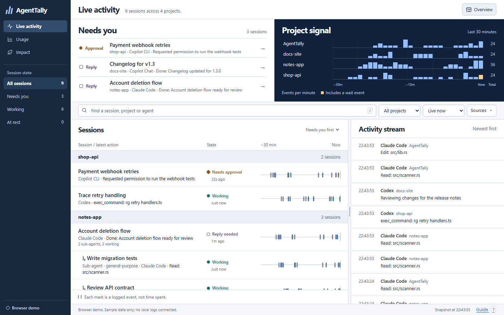
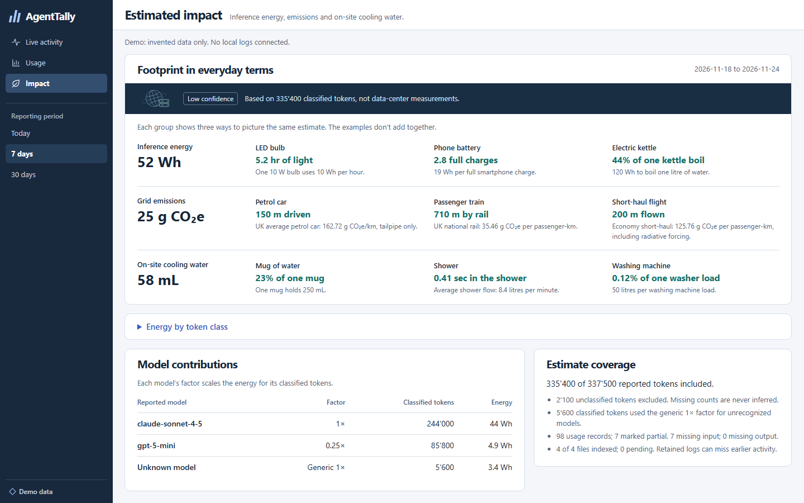

## Keep project follow-ups close

Add a project-scoped follow-up with a title, optional context, and an optional web link. Mark it done, reopen it, edit it, or delete it from the Follow-ups view. Projects come from detected sessions and saved follow-ups.

Follow-ups are stored in a separate local database. They are not inferred from agent activity, written to provider logs, or synced to a service.

## See which agents need you

The **Needs you** queue puts approvals ahead of replies. Select a project’s activity lane to filter its sessions, or select an event to read it while new events continue arriving. Resize the sessions and activity panes or hide the overview; AgentTally remembers your layout.

When no agents are active, **Standing by for activity** replaces the empty panels. Open the last 24 hours if there’s history, or leave the scanner watching; the live workspace returns automatically. On Windows, minimizing to compact status now keeps a single taskbar entry.

## Put the footprint in everyday terms

Open **Impact** for the same period as **Usage**. All nine comparisons are visible together, with their reference amounts. In the example below, 52 Wh is about 5.2 hours of LED light, 2.8 phone charges, **or** 44% of a kettle boil. Those are three ways to describe one estimate, not three impacts to add together.

Both screenshots use simulated data. The installed app uses local logs. Environmental figures are estimates, not measurements; expand **Energy by token class** to inspect the inputs, or read [how the estimates work](https://github.com/kasuken/AgentTally/blob/v0.7.0/docs/usage-methodology.md).

## Downloads

| Platform | File |
|---|---|
| Windows | `AgentTally_*_x64-setup.exe` (installer) or `AgentTally_*_x64_en-US.msi` |
| macOS (Apple Silicon) | `AgentTally_*_aarch64.dmg` |
| macOS (Intel) | `AgentTally_*_x64.dmg` |
| Linux | `AgentTally_*_amd64.AppImage`, `AgentTally_*_amd64.deb` or `AgentTally-*.x86_64.rpm` |

The builds are not code-signed. See the [install guide](https://github.com/kasuken/AgentTally/blob/v0.7.0/README.md#install) for Windows and macOS instructions.
