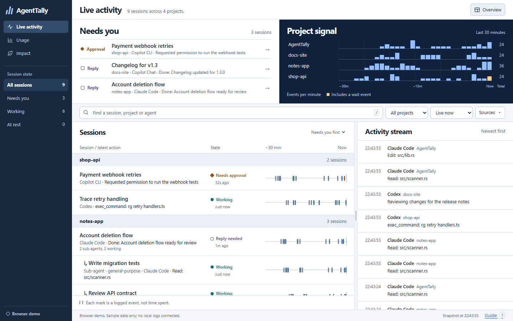
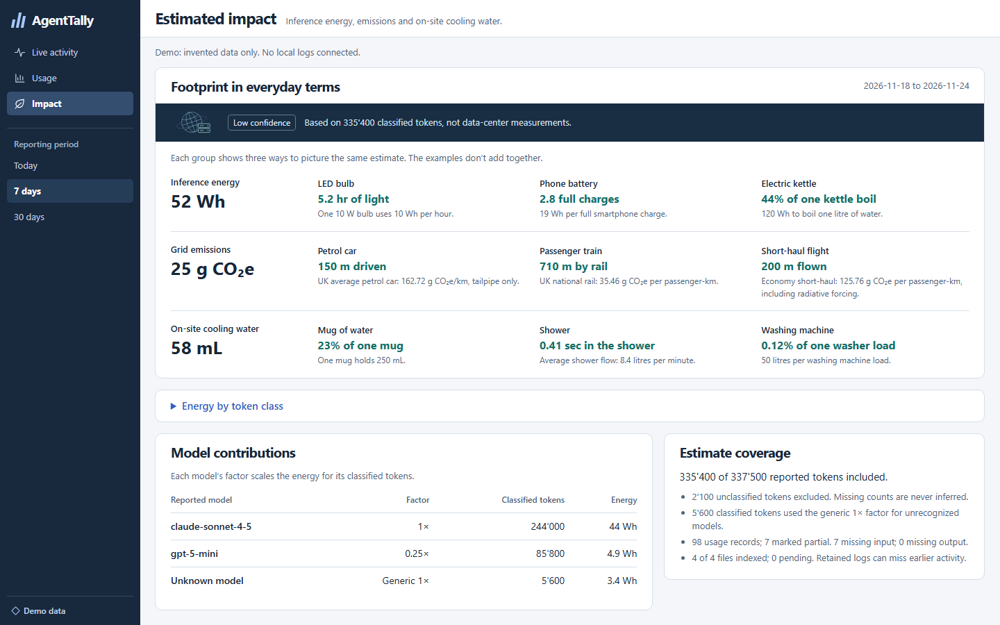
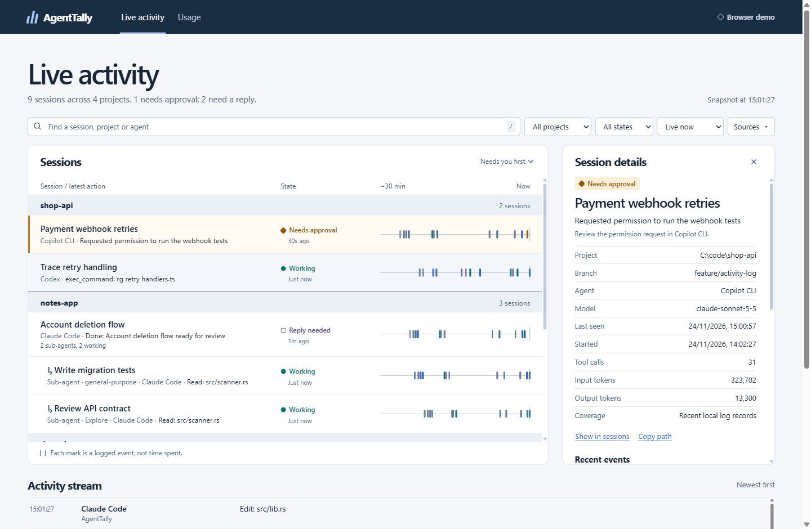
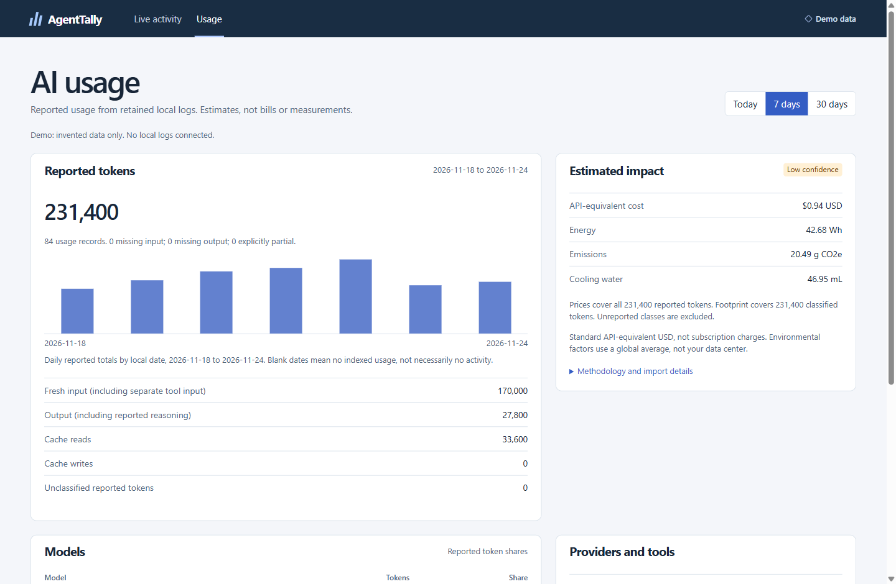

# Changelog

## [0.7.0] - 2026-11-27

### Added

- **Project follow-ups** — Keep a local list of open and completed next steps with optional notes and links. Follow-ups are stored separately from provider logs and are never inferred from agent activity.

## [0.6.0] - 2026-11-24

### Added

- **Attention queue and project activity** — See which sessions need approval or a reply. Select a project’s activity lane to filter the workspace, or select a stream event to inspect it without losing your place as new events arrive.
- **Impact report** — See all nine everyday comparisons together: lighting, charging and boiling for energy; travel distances for emissions; and mugs, showers and washer loads for cooling water. Each group describes the same estimate three ways. Inspect the reference amounts, model contributions and token coverage behind the figures.

### Changed

- **Desktop workspace** — Move between Live activity, Usage and Impact from the navigation rail. Resize the sessions and activity panes or hide the overview; the app remembers your layout. Usage and Impact share a reporting period without changing the live view.
- **Standby when agents are quiet** — Instead of several empty panels, see whether the scanner is watching and open the last 24 hours when history is available. The live workspace returns as soon as activity resumes.

### Fixed

- **One Windows taskbar entry** — Minimizing to compact status no longer adds a second taskbar button.

### Screenshots

Both views use simulated data, not local agent history.

## [0.5.0] - 2026-11-24

### Added

- **Local usage history** — Compare today, the last 7 days, or the last 30 days of reported tokens and tool calls. See which models and providers contributed while the live monitor keeps running.
- **Cost and footprint estimates** — See the API-equivalent cost, energy, emissions, and cooling water associated with reported usage. The Usage view shows which tokens the estimates cover; these figures are not a bill or direct measurements.

### Changed

- **Live activity is the home screen** — One dashboard replaces Pixel, its Cinema mode, and Pro. Sessions are grouped by project, with approvals and replies first. Compare recent events on a shared 30-minute axis, then select a session to inspect its latest action.
- **Compact status on minimize** — A small status window replaces the desktop robot. It names the session that needs attention and shows what the other agents are doing.

### Screenshots

**Live activity.** In this example, Copilot CLI is waiting for permission to run tests while Codex continues tracing retry handling in the same project.

**AI usage.** Seven days of sample activity, with reported tokens on the left and estimates for those tokens on the right.

## [0.4.0] - 2026-11-22

### Added

- **Cinema mode** — Let the camera occasionally follow working agents or approval requests, then return to the overview. Manual camera controls stop it, and it respects reduced-motion settings.

## [0.3.0] - 2026-11-22

### Added

- **Agent office** — Follow sessions between project desks, meeting rooms, the server room, and the lounge as their work changes. Agents that need approval queue at the review desk.
- **Room close-ups** — Jump to the open space, meeting room, lounge, or review desk; use the illustrated guide to learn what each room means.
- **Freight yard** — View projects as depots and sessions as trucks. Press **Y** in Pixel view to cycle maps.

### Changed

- **Pixel view** — The 32-bit-style office replaces the islands as the default map. The team directory now shows matching robot portraits and room assignments. Saved map and interface preferences still apply.
- **Workstations and meetings** — Robots face their monitors at paired desks and sit opposite one another at the conference table. Project names, room signs, and status labels remain visible.
