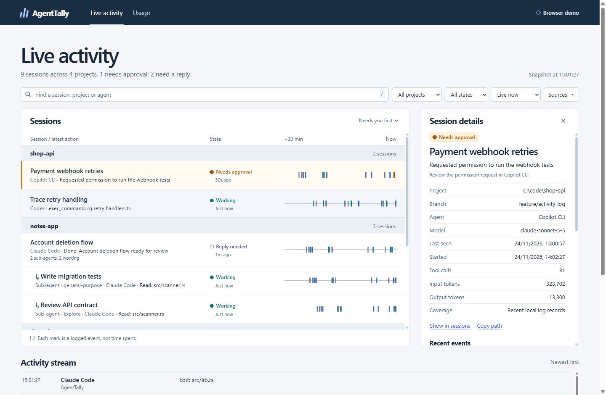
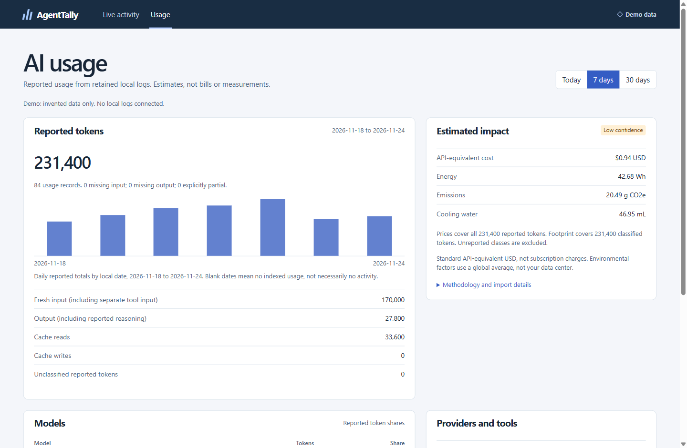

# AgentTally

[](https://github.com/kasuken/AgentTally/releases/latest)
[](https://github.com/kasuken/AgentTally/actions/workflows/ci.yml)

See what the AI coding agents on your machine are doing **right now**. AgentTally groups sessions by project, shows the latest action for each agent, and brings permission requests and completed turns to the top. It reads local logs; you reply to agents and approve requests in their original applications.



## Live activity

- Find a session by project, agent, status, or search. Working sessions and sessions needing attention remain visible in the live view. Sub-agents appear beneath their parent.
- Compare **30-minute timelines** on a common time axis. Each mark is a recent logged event, not a measure of how long an agent worked. Select a session for its model, project, branch, tool calls and timestamped activity.
- Use the activity stream to follow changes across projects. A quiet session is different from a disconnected monitor: interrupted updates keep the last snapshot rather than substituting demo data.
- Minimize the desktop app for a compact status window showing the session that most needs attention. Restore the dashboard from that window.

Updates follow the provider's log writes. The scanner polls tracked logs roughly every 1.2 seconds and looks for new sessions every five polls. A provider that writes only after a request finishes cannot report that request in flight.

## Usage

Open **Usage** for **Today**, **7 days**, or **30 days** of local history. This view is separate from Live: changing the reporting period does not change which agents you see working. The background index reads available logs, so a new installation can recover recent history without waiting a month.

Reported token counts, model and provider breakdowns, and tool calls describe what providers actually recorded. Estimated API-equivalent cost is **not your bill**. Estimated energy, emissions, and cooling water are **not direct measurements**. Missing counts, unsupported models, and incomplete history limit coverage; activity-only agents can still appear on Live. See the [usage methodology](docs/usage-methodology.md) for factors, rates, and limitations.

AgentTally needs no account, telemetry, or remote pricing service. It does not modify provider logs. The usage index is a local SQLite database of accounting records, not a copy of conversations, tool arguments, or source code.



## Supported live sources

| Agent | Local source | What is visible |
| --- | --- | --- |
| Claude Code | `~/.claude/projects/*/*.jsonl`, including `subagents/` | Turns, tools, tokens, titles, sub-agents |
| Codex CLI / desktop | `~/.codex/sessions/YYYY/MM/DD/rollout-*.jsonl` | Turns, tools, tokens, sub-agents |
| GitHub Copilot CLI | `~/.copilot/session-state/*/events.jsonl` | Turns, tools, permission prompts, session names |
| Copilot Chat | VS Code, Insiders, Cursor or VSCodium `User/workspaceStorage/*/chatSessions` | Prompts, tool invocations, titles |
| Gemini CLI | `~/.gemini/tmp/*/chats/session-*.json` | Prompts, tools, tokens |
| Antigravity | `~/.gemini/antigravity*/` | Project, title, run status and available conversation activity |
| OpenCode | `~/.local/share/opencode/opencode.db*` or platform data folder | File activity only |

`CLAUDE_CONFIG_DIR` and `CODEX_HOME` are respected. The live scanner tracks sessions touched in the last 24 hours. **Working** means a turn is open and logged recently (longer for an outstanding tool); **Needs approval** is a pending permission prompt; **Your turn** indicates a recently completed turn. Idle, sleeping, and offline are distinct from these states.

## Install

Download the latest packaged version from [Releases](https://github.com/kasuken/AgentTally/releases/latest). The live dashboard and local usage history are available starting with v0.5.0.

| Platform | Download |
| --- | --- |
| Windows 10/11 | x64 setup `.exe` or `.msi` |
| macOS | `.dmg` for Apple Silicon (`aarch64`) or Intel (`x64`) |
| Linux | `.AppImage`, `.deb`, or `.rpm` |

Builds are not code-signed. On Windows, verify the download source before choosing **More info → Run anyway** in SmartScreen. On macOS, move the app to Applications; if Gatekeeper rejects the verified download, remove its quarantine flag with `xattr -dr com.apple.quarantine /Applications/AgentTally.app`. On Linux, make the AppImage executable with `chmod +x` before launching it.

## Build and preview

Install stable [Rust](https://rustup.rs), Node.js 18+, and the [Tauri prerequisites](https://tauri.app/start/prerequisites/) for your OS.

```sh
npm ci
npm run dev       # desktop app
npm run build     # release binary and installers
npm run preview   # browser preview: http://localhost:5178/?demo
```

The browser demo uses synthetic data; the installed desktop app reads local logs. For a live snapshot from the command line, run `cargo run --manifest-path src-tauri/Cargo.toml -- --dump`. This output can include sensitive project and activity text.

```sh
npm test
cargo test --manifest-path src-tauri/Cargo.toml
```

To exercise browser recovery without reading real logs, run `node tests/fixture-server.mjs <absolute-mode-file>` and open `http://localhost:5179/?live`. Write `ready`, `empty`, or `error` to the mode file. For native debug builds, set `AGENT_TALLY_FIXTURE_ROOT` to an absolute folder containing synthetic provider directories (`.claude/projects`, `.codex/sessions`, `.copilot/session-state`, `Code/User`, `.gemini`, `opencode`). This selects only those sources and a separate local history database. Release builds do not use this override.

### Releasing

Keep the version in `package.json`, `src-tauri/Cargo.toml`, `src-tauri/tauri.conf.json` and their lockfiles in sync. Update `.github/release-notes.md`, then tag `vX.Y.Z`; GitHub Actions builds the installers for Windows, Linux and macOS.

### Design references

The usage reporting draws on [AI Engineering Fluency](https://github.com/rajbos/ai-engineering-fluency) for local token and model reporting and [CarbonBit](https://github.com/kasuken/vscode-carbonbit) for transparent environmental estimates. Neither tool is required to use AgentTally.
